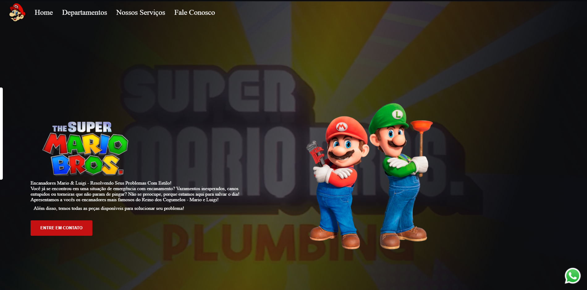

# 🍄 Super Mario Bros - Landing Page

Uma landing page temática e totalmente responsiva inspirada nos **Irmãos Mario**, desenvolvida com foco em design moderno, interatividade e adaptação perfeita para dispositivos móveis.

---

### 🌐 Demonstração Online

Quer ver a aplicação rodando no navegador? Teste agora mesmo:

👉 **[Clique aqui para ver o site ao vivo](https://lmvc007.github.io/mario/)**

---

### 📸 Preview do Projeto

<p align="center">
  
</p>

---

### ✨ Funcionalidades e Destaques

- 📱 **Design Responsivo:** Adaptado tanto para telas de computadores quanto para smartphones e tablets (*Mobile First*).

- 🎮 **Interface Interativa:** Elementos visuais dinâmicos utilizando JavaScript.

- 🎨 **Estilização Temática:** Layout estilizado com referências diretas ao universo do Mario.

---

### 🛠️ Tecnologias Utilizadas

- **HTML5:** Marcação e estrutura semântica dos elementos.

- **CSS3:** Estilos, animações, efeitos visuais e *media queries* para responsividade.

- **JavaScript:** Lógica de comportamento e manipulação do DOM.

---

### 💻 Como rodar o projeto localmente

Para clonar e testar o código no seu ambiente:

1. Clone o repositório:
```bash
git clone https://github.com/LMVC007/mario.git
